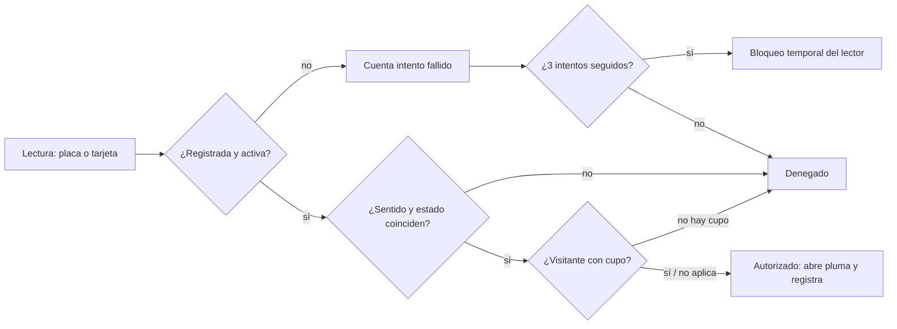

# C.I.S.P.P.H. — Control de Ingreso y Salida para Parqueaderos de Propiedad Horizontal

Proyecto académico de **Diseño de Software I** (Escuela Tecnológica Instituto Técnico Central, ETITC). Reúne la documentación del proyecto, un **simulador 3D** del control de acceso y un **prototipo con Arduino** cuya lógica se prueba en un computador.

> **Aviso.** El cliente y el conjunto residencial del caso son **ficticios**. No hay entrevistas, observaciones ni datos reales; todo valor del repositorio es ilustrativo. Para redactar y organizar el material el equipo usó Claude (Anthropic) como herramienta de apoyo; las decisiones y la revisión final corresponden al equipo y al docente.

**Equipo:** Luis David Caicedo Rodríguez (Product Owner) · Edisson David Vargas Castiblanco (Scrum Master) · Javier Santiago Pérez Tobon (Developer)
**Docente:** José Del Carmen Ortega Castro · **Entrega:** 21/11/2026

## Contenido del repositorio

| Carpeta | Qué hay | Estado |
|---|---|---|
| [`simulador/`](simulador/) | Simulador 3D en Godot 4.7 (GDScript): garita, barreras, parqueadero, guarda y administración | Pruebas automáticas del núcleo de reglas: 0 fallos. Sonido y equipos físicos sin probar |
| [`prototipo-arduino/`](prototipo-arduino/) | Núcleo de reglas en C++ (`cispph_core.h`), sketch de Arduino UNO y pruebas en PC | Reglas: 23 pruebas, 0 fallos. Sketch ejecutado en simulación de PC; **sin probar en hardware ni compilado con la cadena de Arduino** |
| [`docs/documentos/`](docs/documentos/) | Documentos del proyecto en formato APA 7 (.docx / .xlsx) | Versión 2.0, pendientes de validación del docente |
| [`docs/uml/`](docs/uml/) | Fuentes PlantUML y imágenes de los diagramas | Generados con PlantUML |

## Cómo funciona el sistema

El control de acceso decide, para cada lectura (una placa digitada o una tarjeta RFID), si un vehículo puede **entrar** o **salir**, y deja un registro de cada decisión.



Reglas principales (propuestas del equipo, ver [`docs/documentos`](docs/documentos/)):

- **Categorías** definidas como trabajo, pendientes de ratificar: *No VIP* (residente con parqueadero privado), *VIS* (visitante) y *VIP* (trato diferenciado).
- Los parqueaderos de visitantes son un **contador compartido**: no se reservan a un apartamento (Ley 675 de 2001, art. 22).
- Una persona no entra dos veces seguidas ni sale sin haber entrado.
- Tres lecturas inválidas seguidas bloquean el lector por un tiempo configurable.
- Cada movimiento queda con fecha-hora, sentido, decisión y categoría (trazabilidad).
- **No se implementan** tarifas, minutos de gracia ni cobros: el equipo aún no los define.

### Arquitectura

La lógica de decisión está **separada de la interfaz y del hardware**. En el simulador vive en el *autoload* `Sistema` (GDScript); en el prototipo, en `cispph_core.h` (C++ sin dependencias de Arduino), por lo que las mismas reglas se prueban con `g++` en un PC antes de cargarlas en el microcontrolador. Ambas implementaciones siguen el mismo diseño de reglas; no comparten código.

## Simulador (Godot)

1. Instale Godot 4.7.x (versión estándar, sin .NET).
2. Abra `simulador/project.godot` y pulse **F5**.
3. Ingrese con `admin` / `admin123` (credencial de demostración; se guarda como hash SHA-256).

Pruebas del núcleo de reglas (sin interfaz):

```bash
cd simulador
godot --headless --path . -s res://tools/pruebas/prueba_sistema.gd
```

Resultado en la última ejecución: `FALLOS SISTEMA: 0`. La lectura de placa y el reconocimiento facial del simulador son **simulados**, no hay OCR ni reconocimiento real. Más detalle en [`simulador/docs/`](simulador/docs/).

## Prototipo Arduino

Ver [`prototipo-arduino/README.md`](prototipo-arduino/README.md): cableado, librerías, cómo probar las reglas en PC y qué falta por verificar en hardware.

```bash
cd prototipo-arduino/pruebas
g++ -std=c++11 -Wall -Wextra -Wpedantic -o test_core test_core.cpp && ./test_core
```

## Documentación

Los documentos siguen APA 7 y la numeración de la carpeta del proyecto: acta, roles, caso del cliente, narrativa, normativa, cuestionarios, requisitos, backlog y burndown, Scrum, EDT/cronograma, BPMN, UML, modelo de datos, SDD, UI/UX y herramientas comerciales. Ver [`docs/README.md`](docs/README.md).

## Limitaciones conocidas

- Cliente ficticio: ninguna necesidad está validada con usuarios reales; los umbrales (por ejemplo 3 s por registro) son propuestos.
- El prototipo Arduino no se ha cableado ni probado con un MFRC522, servo o LCD reales.
- El sonido del simulador no se ha escuchado y no se probó en un teléfono ni en un `.exe` de Windows.
- Los estados de entrega los marca el docente, no el equipo.
